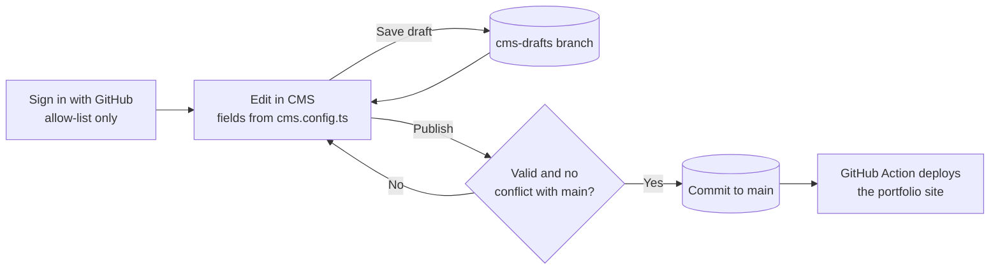

I build and deployed my portfolio on the [nishant-k-sagar](https://nishant-k-sagar.github.io). It was clean and nicely deployed and was working in prod as expected.
The portfolio is completely custom and I added functionalities such that posting blogs, projects, keeping the timeline correct and other related details about me. But I was facing a issue with managing content. I needed to write up the content from my github repo and then deploy the changes onto merge(I'll add portfolio architecture breakdown blog link here).

To solve this problem, I came the portfolio-cms into life.

## Purposes

As mentioned earlier, It allowed me to do many things
1. I could edit, delete, publish content of my live portfolio.
2. It does not need my manual deployment now - complete pipeline works on it's own.
3. I can publish the content from my mobile or any device by visiting [nishant-cms](https://nishant-cms.pages.dev)
4. It is configured for single repo on my account only - so even someone tries to auth their Github sign-in, It won't work the same way.

## Workflow

Okay, so before we start, the portfolio-cms is tightly coupled with the architecture of my portfolio website to match the styling, fonts, structuring, listing the content, and listing related things.

Okay, so before we start, the portfolio-cms is tightly coupled with the architecture of my portfolio website to match the styling, fonts, structuring, listing the content, and listing related things. There is no separate database. The website’s markdown files in GitHub are the content, and the CMS is just an easier way to edit them. Everything it knows about the website lives in cms.config.ts, so when the website’s content schema changes, this file has to change too.

Saving a draft only goes to a cms-drafts branch, so the live site stays safe. Publishing validates the fields, checks that main has not changed since the draft started, commits to main and cleans up the draft. The website’s GitHub Action then deploys it.

## In detail discussion
Okay, so before we start, the portfolio-cms is tightly coupled with the architecture of my portfolio website to match the styling, fonts, structuring, listing the content, and listing related things. There is no separate database in it. The website’s markdown files in the GitHub repo are the content, and the CMS is just a nicer way to edit them. It is a small app hosted on Cloudflare Pages, and I sign in with GitHub. Only the logins in my allow-list can get in.

Everything it knows about the website lives in one file, cms.config.ts. It lists each collection (blog, projects, pages, timeline, skills, socials, home intro and experience) with the folder it writes to and the fields the website expects. So if the website’s content schema changes, this config has to change with it, otherwise the website build can break. That is also why I run the contract tests against the website’s content.config.ts.

When I write something, I pick a collection and fill in the editor, which has a markdown toolbar, a preview tab and autosave. Saving a draft does not touch the live site. It goes to a separate cms-drafts branch, so the website stays safe until I decide. Images are resized and converted to WebP in the browser before they are saved into public/images.

Publishing is the careful part. The CMS checks every field strictly, then checks that the file on main did not change since I started the draft. After that it commits the file to main and cleans up the draft. The website’s GitHub Action sees that commit and deploys the site. Delete works the same way, and archiving an entry just hides it from the site.

## Tech stack
- TypeScript
- Node
- Preact
- marked - for turing markdown into HTML, and DOMPurify sanitises that HTML
- mermaid
- CSS
- Cloudflare Pages
- Github Oauth
- Github RESTapi
- Zod

for tooling and testing-
- Vitest and jsdom for unit tests
- Playwright for e2e testing
- Wrangler
